<!-- Sync with EN rev 792beb6 (2026-10-12) -->
# ElecPilot
<a id="readme-top"></a>

[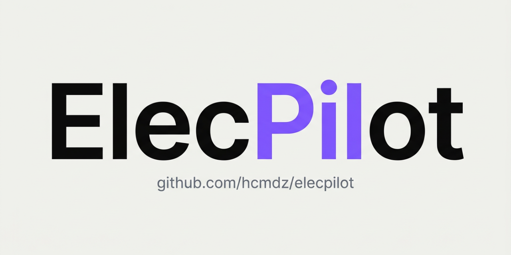](https://github.com/Hcmdz/ElecPilot/releases/latest)

**Lire ceci dans d'autres langues**

🇺🇸 [English](../../README.md) | 🇫🇷 [Français](README.fr-FR.md) | 🇸🇦 [العربية](README.ar-SA.md)
<!-- Localized app: values-fr/values-ar (+ldrtl) mirror README langs; supportsRtl verified. -->

<div align="center">
   <a href="https://github.com/Hcmdz/ElecPilot/releases">
      
   </a>
   <a href="https://apps.obtainium.imranr.dev/redirect?r=obtainium://add/https://github.com/Hcmdz/ElecPilot/">
      
   </a>
</div>

<br />

[](https://www.android.com)
[](https://kotlinlang.org)
[](#)
[](#)
[](https://www.gnu.org/licenses/gpl-3.0)
[](https://github.com/Hcmdz/ElecPilot/releases/latest)
[](https://github.com/Hcmdz/ElecPilot/releases)
[](https://github.com/Hcmdz/ElecPilot/stargazers)
[](https://github.com/Hcmdz/ElecPilot/network/members)
[](https://developer.android.com/jetpack/compose)

Application Android de gestion des démarreurs de moteurs électriques et des modules d'E/S d'automates (PLC) en environnement industriel.

Sur le terrain, les données moteurs vivent sur papier ou dans des tableurs éparpillés — perdues, obsolètes, introuvables. ElecPilot est le carnet de terrain offline-first : chaque démarreur et chaque module PLC enregistré une fois, retrouvé en quelques secondes, exportable en Excel ou CSV.

- **Package**: `com.HcmDz.ElecPilot`
- **Version**: 6.5.4 (versionCode 34)
- **Author**: HcmDZ &lt;[REDACTED]&gt;

---

<p align="center">
  <a href="#captures-décran">Voir la démo</a>
  ·
  <a href="https://github.com/Hcmdz/ElecPilot/issues/new?labels=bug">Signaler un bug</a>
  ·
  <a href="https://github.com/Hcmdz/ElecPilot/issues/new?labels=enhancement">Proposer une fonctionnalité</a>
</p>

<details>
<summary>Table des matières</summary>

- [📦 Téléchargements](#-téléchargements)
- [Captures d'écran](#captures-décran)
- [Fonctionnalités clés](#fonctionnalités-clés)
- [Stack technique et architecture](#️-stack-technique-et-architecture)
- [Démarrage](#-démarrage)
- [Tests](#-tests)
- [Structure du projet](#-structure-du-projet)
- [Apache POI Shadow Jar](#apache-poi-shadow-jar)
- [Signature](#signature)
- [Taille de l'APK](#taille-de-lapk)
- [Changelog](#changelog-v57--v654)
- [Mentions légales](#mentions-légales)
- [Licence](#licence)
- [Roadmap](#️-roadmap)
- [Docs associées](#docs-associées)
- [Contact](#-contact)
</details>

---

## 📦 Téléchargements

Obtenez ElecPilot sur GitHub : **[Dernière release](https://github.com/Hcmdz/ElecPilot/releases/latest)** (`ElecPilot-release.apk`, ~13.3 MB, `arm64-v8a`).

[](https://github.com/Hcmdz/ElecPilot/releases/latest)

- Nécessite Android 9+ (API 29) avec **arm64-v8a** ; autorisez *Installer des applications inconnues* pour votre navigateur si demandé.
- Vérifiez l'intégrité : `sha256sum -c ElecPilot-release.apk.sha256` (fichier sidecar à côté de l'APK).
- ⚠️ Si vous venez d'une version ≤ 6.5 : réinstallation manuelle requise (nouvelle clé de signature depuis 6.5.1 — sauvegardez, désinstallez, installez, restaurez).

<p align="right">(<a href="#readme-top">haut de page</a>)</p>

---

## Captures d'écran

Retrouvez n'importe quel démarreur en quelques secondes, en clair ou en sombre — listes, détails et réglages en un coup d'œil.

### Démarreurs de moteurs

<div align="center">

| Liste des moteurs — vue tableau (mode clair) | Liste des moteurs — vue tableau (mode sombre) |
|---|---|
| <a href="../../screenshots/motor-list-table-view-light.png">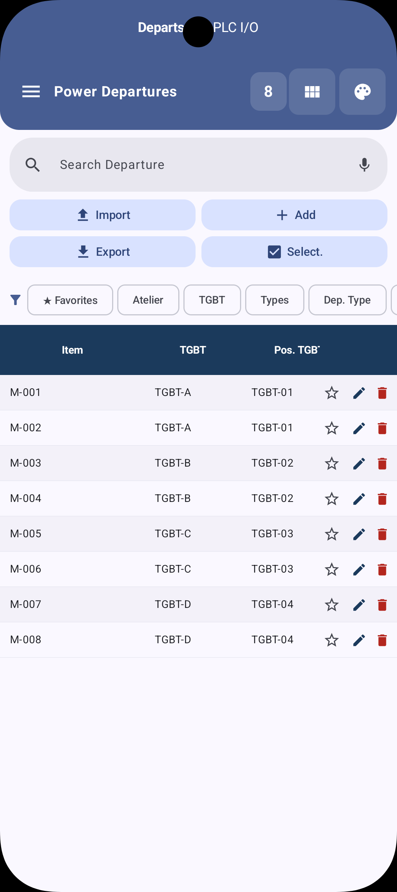</a> | <a href="../../screenshots/motor-list-table-view-dark.png">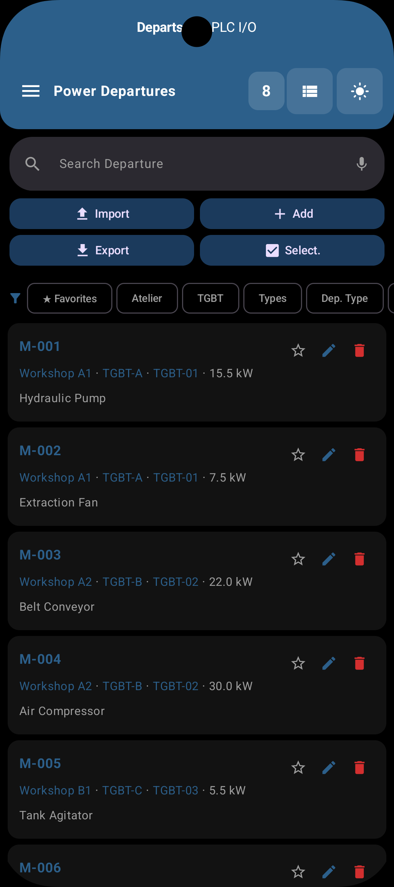</a> |
| Liste des moteurs — vue cartes (mode clair) | Fiche moteur (mode sombre) |
| <a href="../../screenshots/motor-list-card-view-light.png">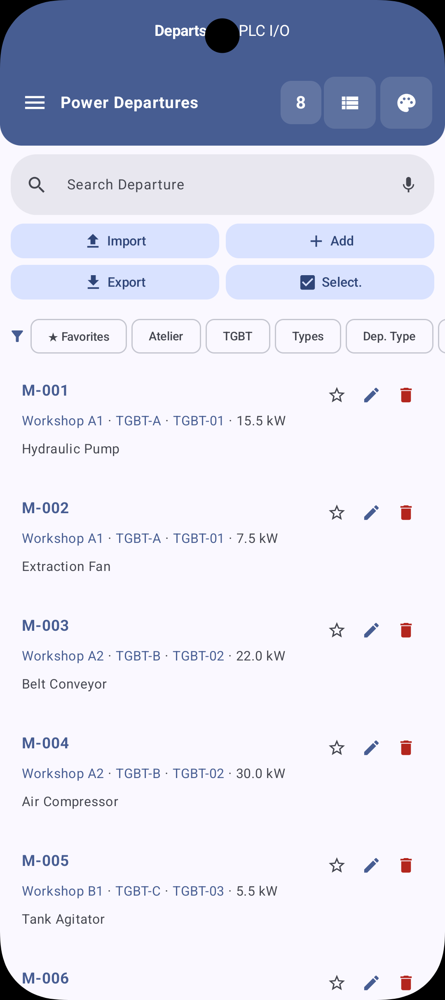</a> | <a href="../../screenshots/motor-detail-dark.png">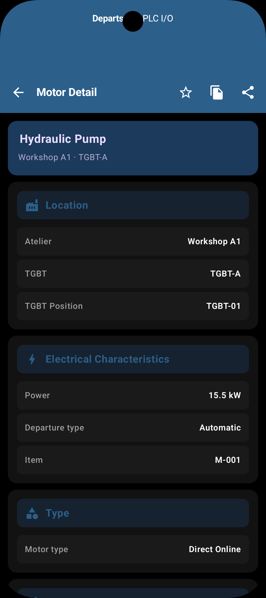</a> |

</div>

### Modules d'E/S PLC

Chaque module est enregistré — vue tableau ou cartes, avec le détail complet par module.

<div align="center">

| Liste des E/S PLC — vue cartes (mode clair) | Liste des E/S PLC — vue cartes (mode sombre) |
|---|---|
| <a href="../../screenshots/plc-list-card-view-light.png">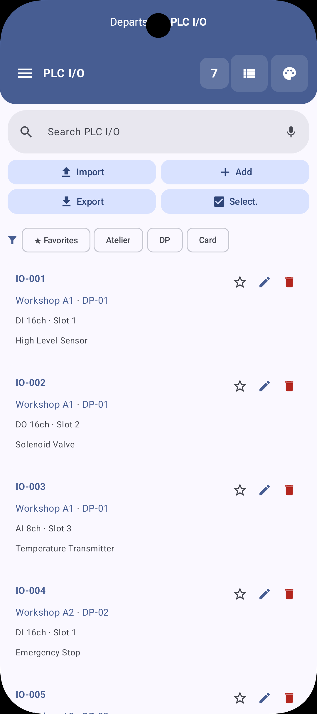</a> | <a href="../../screenshots/plc-list-card-view-dark.png">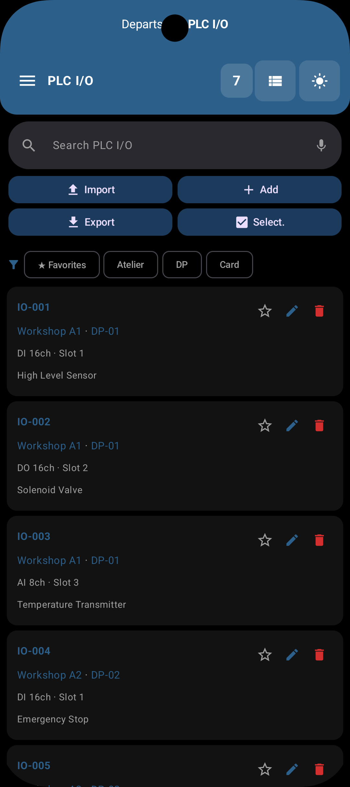</a> |
| Liste des E/S PLC — vue tableau (mode clair) | Fiche E/S PLC (mode sombre) |
| <a href="../../screenshots/plc-list-table-view-light.png">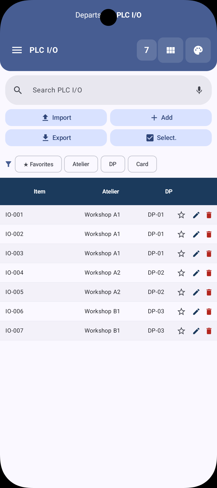</a> | <a href="../../screenshots/plc-detail-dark.png">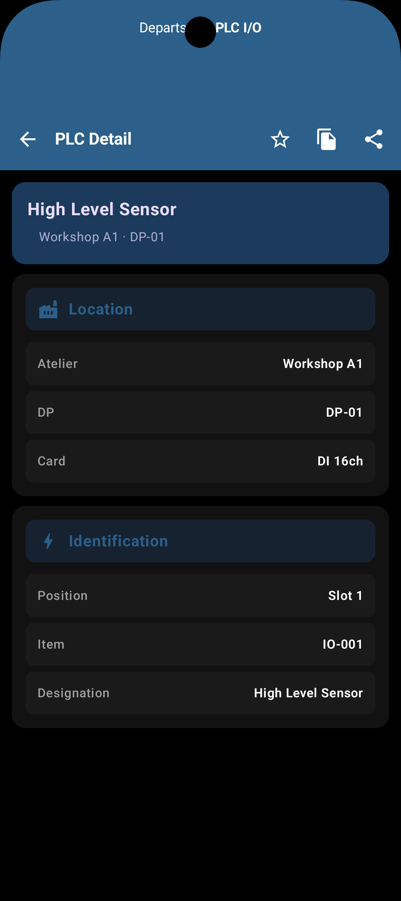</a> |

</div>

### Réglages

Sauvegarde, langue et mises à jour — tout est configurable au même endroit.

<div align="center">

| Réglages (mode clair) | Réglages (mode sombre) |
|---|---|
| <a href="../../screenshots/settings-light.png">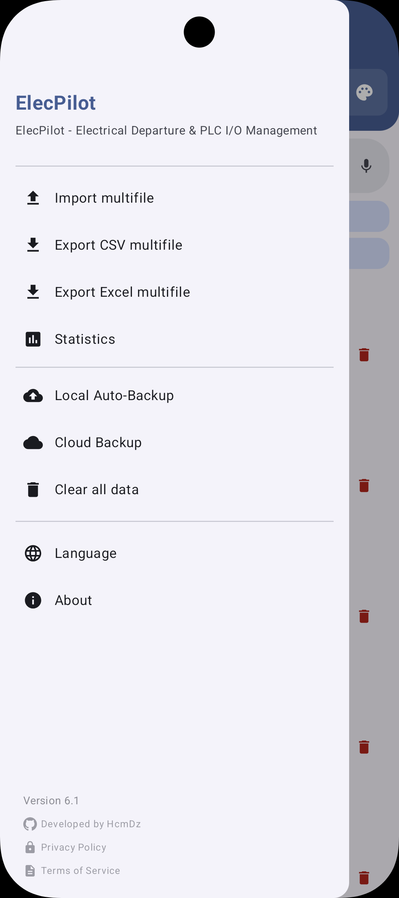</a> | <a href="../../screenshots/settings-dark.png">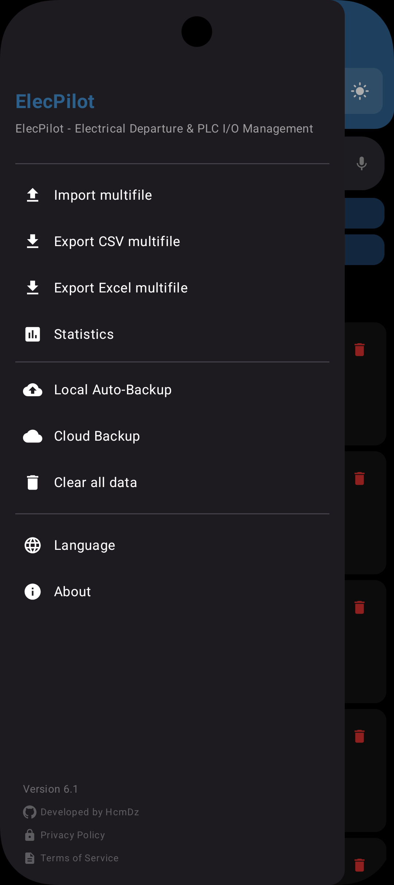</a> |

</div>

<p align="right">(<a href="#readme-top">haut de page</a>)</p>

---

## Fonctionnalités clés

### Démarreurs de moteurs
- **Chaque démarreur est enregistré.** CRUD complet, recherche, édition par lot, statistiques.
- **Recherche mains-libres.** Parlez pour filtrer les démarreurs avec la recherche vocale.
- **Partez d'une feuille propre.** Modèles Excel prêts à remplir pour les démarreurs et les E/S PLC.

### Modules d'E/S PLC
- **Chaque module est enregistré.** Base de données et vues dédiées aux modules d'E/S PLC.

### Sauvegarde et synchronisation
- **Vos données survivent au téléphone.** Sauvegarde locale planifiée vers un dossier de votre choix, plus une sauvegarde manuelle à tout moment.
- **Trace écrite à la demande.** Sauvegarde locale avec export/import Excel et CSV et sauvegardes planifiées.

### Application
- **Toujours à jour.** Mise à jour intégrée avec vérification auto et téléchargement depuis GitHub Releases.
- **Comme à la maison.** Thème Material You avec couleur dynamique, edge-to-edge.
- **Parle votre langue.** Localisation Système/EN/FR/AR avec détection auto de la langue de l'appareil.
- **Durcie par défaut.** FLAG_SECURE, cleartext bloqué, sauvegardes Android désactivées, suppression des logs ProGuard.

<p align="right">(<a href="#readme-top">haut de page</a>)</p>

---

## 🛠️ Stack technique et architecture

### Architecture

- Application **monomodule** avec `MainActivity` + navigation Jetpack Compose
- Couche données : bases Room + pattern Repository
- ViewModels avec StateFlow
- WorkManager pour les sauvegardes locales planifiées

### Bibliothèques et outils principaux

| Catégorie | Bibliothèque | Version |
|---|---|---|
| **UI** | Jetpack Compose + Material 3 | BOM 2026.09.00 |
| **Activity** | Activity Compose | 1.13.0 |
| **Lifecycle** | Lifecycle Runtime Compose | 2.11.0 |
| **Async** | Kotlin Coroutines & Flow | 1.11.0 |
| **Database** | Room | 2.8.5 |
| **Networking** | OkHttp | 5.5.0 |
| **Excel** | Apache POI (shadow jar de centic9/poi-on-android) | 5.2.5 |
| **Scheduling** | WorkManager | 2.12.0 |
| **File Access** | DocumentFile (SAF) | 1.1.0 |
| **Security** | ProGuard, configuration de sécurité réseau | — |
| **Build** | AGP 9.4.1, Kotlin 2.4.21, KSP 2.3.12 | — |
| **Lint** | Android Security Lint | 1.0.4 |
| **Quality** | Detekt CLI | 1.23.8 |
| **Testing** | JUnit4, Room Testing, Coroutines Test | 4.13.2 / 2.8.5 / 1.11.0 |

### Fonctionnalités de sécurité (v6.0)

| Contrôle | Implémentation |
|---|---|
| **Protection captures d'écran** | `FLAG_SECURE` sur MainActivity |
| **Suppression des logs** | ProGuard supprime `Log.d/v/i/e/w` (y compris les stack traces d'exceptions) en release |
| **Sécurité réseau** | Cleartext bloqué (`network_security_config.xml`), certificats système uniquement |
| **Sauvegarde désactivée** | `allowBackup="false"` |
| **MTE** | `memtagMode="sync"` activé dans le manifest |

### Permissions

- `INTERNET`, `ACCESS_NETWORK_STATE` — vérification et téléchargement des mises à jour
- `POST_NOTIFICATIONS` — progression des sauvegardes et statut des mises à jour
- `REQUEST_INSTALL_PACKAGES` — installation des mises à jour intégrées

Points d'entrée : `MainActivity` (launcher), `FileProvider` (`${applicationId}.fileprovider`).

### CI et qualité

- GitHub Actions : `.github/workflows/ci.yml` (`testDebugUnitTest` + `lintDebug`), `codeql.yml`, Dependabot
- Detekt : `./gradlew detekt` (config `config/detekt/detekt.yml`)
- Noms de variables CI requises (les valeurs restent dans les secrets du repo/environnement, jamais commitées) : identifiants du keystore release (`RELEASE_STORE_FILE`, `RELEASE_STORE_PASSWORD`, `RELEASE_KEY_ALIAS`, `RELEASE_KEY_PASSWORD`)

<p align="right">(<a href="#readme-top">haut de page</a>)</p>

---

## 🚀 Démarrage

### Prérequis

- **Android Studio** : dernière stable (Meerkat ou plus récent) — IDE ([doc](https://developer.android.com/studio))
- **JDK** : 17 — toolchain Gradle ([doc](https://docs.gradle.org/current/userguide/build_java_projects.html))
- **Android SDK** : compileSdk 37 ([installation](https://developer.android.com/studio#downloads))

### Build APK

```bash
cd "ElecPilot"
./gradlew assembleRelease
```

Sortie : `app/build/outputs/apk/release/ElecPilot-release.apk`

### Utilisation quotidienne

```bash
./gradlew installDebug   # run on device
./gradlew test           # unit tests
./gradlew lintDebug      # static analysis
```

### Lancer sur appareil

1. Ouvrez le projet dans **Android Studio**.
2. Attendez la fin de la synchronisation Gradle.
3. Sélectionnez un appareil ou un émulateur sous **API 29+**.
4. Appuyez sur **Run** (Shift + F10) ou :
   ```bash
   ./gradlew installDebug
   ```

<p align="right">(<a href="#readme-top">haut de page</a>)</p>

---

## 🧪 Tests

```bash
./gradlew test
./gradlew connectedAndroidTest
```

---

## 📁 Structure du projet

```
app/src/main/java/com/HcmDz/ElecPilot/
├── MainActivity.kt              # Single activity, edge-to-edge, FLAG_SECURE
├── data/
│   ├── db/                      # Room databases (Motor + PLC)
│   ├── repository/              # Data repositories
│   ├── BackupPreferences.kt     # Local backup settings models
│   ├── CloudBackupPreferences.kt # Cloud backup settings models
│   └── CloudBackupFileInfo.kt   # Cloud file metadata
├── ui/
│   ├── screens/                 # Compose screens (Main, MotorDetail, dialogs)
│   ├── viewmodel/               # ViewModels
│   ├── components/              # Reusable UI components
│   ├── theme/                   # Material 3 theming
│   └── views/plc/               # PLC-specific views
├── util/
│   ├── BackupManager.kt         # Local backup (Excel/CSV)
│   ├── ExcelUtil.kt             # Apache POI export/import + templates
│   ├── UpdateManager.kt         # In-app update (GitHub Releases)
│   ├── ContextUtils.kt          # Locale-aware context helpers
│   ├── NotificationHelper.kt    # Backup notifications
│   ├── BackupScheduler.kt       # WorkManager: local backup schedule
│   └── CloudBackupScheduler.kt  # WorkManager: cloud backup schedule
└── worker/
    └── BackupWorker.kt          # WorkManager: local backup
    └── CloudBackupWorker.kt     # WorkManager: cloud backup
```

---

## Apache POI Shadow Jar

Apache POI est fourni comme shadow jar précompilé de [centic9/poi-on-android](https://github.com/centic9/poi-on-android) plutôt que comme dépendance Maven standard.

### Pourquoi un shadow jar ?

Le POI Maven brut + R8 (le minifieur Android) est fondamentalement cassé. L'obfuscation R8 casse le parsing des noms de classes `SchemaTypeSystemImpl` de xmlbeans, et le shrinking R8 génère des classes bridge synthétiques cassées. Le shadow jar résout cela en :

- Relocalisant `javax.xml.stream` → `org.apache.poi.javax.xml.stream` (Android n'a pas l'API StAX complète)
- Relocalisant `javax.xml.namespace` → `org.apache.poi.javax.xml.namespace`
- Remplaçant les classes `java.awt.*` manquantes par des stubs
- Embarquant l'implémentation StAX [aalto-xml](https://github.com/FasterXML/aalto-xml)
- Fusionnant toutes les dépendances POI en un seul jar

Le shadow jar se trouve à `app/libs/poishadow-all.jar` (~19.5 MB brut). R8 supprime les classes POI inutilisées dans les builds release.

### Propriétés système

Les parseurs StAX relocalisés nécessitent des propriétés système définies avant tout appel POI. C'est géré dans `ExcelUtil.kt` :

```kotlin
System.setProperty("org.apache.poi.javax.xml.stream.XMLInputFactory", "com.fasterxml.aalto.stax.InputFactoryImpl")
System.setProperty("org.apache.poi.javax.xml.stream.XMLOutputFactory", "com.fasterxml.aalto.stax.OutputFactoryImpl")
System.setProperty("org.apache.poi.javax.xml.stream.XMLEventFactory", "com.fasterxml.aalto.stax.EventFactoryImpl")
System.setProperty("org.apache.poi.ss.ignoreMissingFontSystem", "true")
```

### Mettre à jour le shadow jar

Pour construire une version plus récente :

```bash
git clone https://github.com/centic9/poi-on-android.git
cd poi-on-android
./gradlew :poishadow:shadowJar
cp poishadow/build/libs/poishadow-all.jar <path-to-ElecPilot>/app/libs/
```

La branche master de centic9/poi-on-android utilise POI 5.5.1. La release précompilée (5.2.5-4) utilise POI 5.2.5. Les deux conviennent pour la lecture/écriture xlsx de base.

---

## Signature

L'APK release est signé avec un keystore. Pour construire un APK release :

1. Créez un fichier `gradle.properties` à la racine du projet (déjà gitignoré)
2. Ajoutez les propriétés suivantes :

```properties
RELEASE_STORE_FILE=/path/to/your/release.keystore
RELEASE_KEY_ALIAS=ALIAS
RELEASE_STORE_[REDACTED:password]
RELEASE_KEY_[REDACTED:password]
```

3. Lancez `./gradlew assembleRelease`

---

## Taille de l'APK

Taille actuelle de l'APK release : **13,3 MB** (13 948 290 octets, `arm64-v8a` uniquement, R8 activé) — mesurée sur l'asset v6.5.3 publié.

| Contenu | Non compressé | Part |
|---|---|---|
| Code applicatif (dex, R8 + Compose + Room + OkHttp) | ~11,6 Mo | 76 % |
| Ressources Apache POI / xmlbeans | ~3,0 Mo | 20 % |
| Autres ressources et assets | ~0,6 Mo | 4 % |
| Bibliothèques natives | ~10 Ko | <1 % |

Techniques de réduction appliquées :
- POI shadow jar + R8 pour supprimer les classes Apache POI/xmlbeans inutilisées
- `abiFilters` restreint à `arm64-v8a` pour les builds release
- `isMinifyEnabled = true` + `isShrinkResources = true` avec règles ProGuard de centic9/poi-on-android

L'APK pesait 20,3 Mo avant v6.5.3 ; le retrait du binaire natif rclone a supprimé ~7 Mo.

---

## Changelog (v5.7 → v6.5.4)

Les versions suivent [semver](https://semver.org/) ; l'historique complet est dans les [GitHub Releases](https://github.com/Hcmdz/ElecPilot/releases).

### v6.5.4

- **Suppression du cloud backup terminée** — les fichiers restants, le point d'entrée OAuth et l'exception réseau locale sont supprimés
- **Documentation corrigée** — la liste des fonctionnalités, le tableau de sécurité, les permissions et la taille de l'APK décrivent maintenant ce que l'application fait réellement
- Signé avec le même certificat que v6.5.3 : mise à jour en place normale

### v6.5.3

- **Suppression du cloud backup** — Google exige désormais que chaque application utilise son propre projet Cloud pour OAuth ; le projet partagé utilisé par rclone n'est plus accepté
- **Taille de l'APK 20,3 Mo → 13,3 Mo** — le binaire natif rclone embarqué est supprimé
- Inchangé : sauvegarde locale planifiée, import-export CSV/Excel, recherche, filtres, statistiques, recherche vocale, mise à jour intégrée, EN/FR/AR

### v6.5.2

- **La langue système s'applique sans redémarrage** — revenir à l'option *Système* suit désormais la langue système actuelle au lieu de la langue précédemment sélectionnée

### v6.5.1

- **Rclone 1.75.1 allégé** — backends local/Drive/OneDrive uniquement
- **Nouvelle clé de signature** — réinstallation manuelle requise (sauvegardez, désinstallez, installez, restaurez)

### v6.5

- **Tâches de fond annulables sans erreur** — `CancellationException` relancée dans les chemins sauvegarde cloud/locale, vérification de mise à jour et import (plus de fausse notification d'échec ni de retry après annulation)
- **Écritures snapshot sur Main** — les dialogues de sauvegarde réassignent l'état UI sur le thread principal
- **Noms de fichiers de sauvegarde ASCII** — horodatages export/cloud en `Locale.US` (plus de chiffres non latins sous locale arabe)
- **Polish cartes PLC** — taille de l'étoile favori alignée sur les cartes moteurs (18.dp)
- **Build** — AGP 9.4.0, OkHttp 5.5.0, WorkManager 2.11.2

### v6.3

- **Plus d'écran blanc au démarrage à froid** — l'écran complet est conditionné à `hasLoadedOnce` pour ne jamais dessiner le shell vide (header avec compteur « 0 ») avant le premier chargement
- **Dernier module persistant** — l'app rouvre sur le dernier module actif (Départs / PLC I/O) après un redémarrage à froid

### v6.2

- **Mise à jour intégrée** — vérification auto des GitHub Releases, téléchargement et installation avec progression
- **Génération de modèles vierges** — modèles Excel prêts à remplir (headers EN/FR)
- **Option langue système** — détection auto de la langue de l'appareil à la première installation
- **Corrections** — gestion CancellationException, assainissement des noms de fichiers, seuils de validation des headers, garde de file d'export
- **Audit sécurité** — fonctionnalités mise à jour et modèles durcies (recommandation SHA-256, prévention path traversal)

### v6.0 → v6.1

Correctifs d'audit sécurité (OWASP MASVS 2.1) :

| # | Sévérité | Correctif |
|---|---|---|
| 1 | CRITIQUE | Fichier temp de config rclone : permissions lisibles par le propriétaire uniquement |
| 2 | HAUTE | Allowlist d'URL WebView OAuth contre le phishing |
| 4 | MOYENNE | Cache disque sauvegarde cloud chiffré (AES-256-GCM) |
| 5 | MOYENNE | `FLAG_SECURE` sur MainActivity (protection capture/enregistrement) |
| 7 | BASSE | Repli env HOME utilise `filesDir` au lieu d'un chemin en dur |
| 8 | BASSE | Usage explicite de SharedPreferences `MODE_PRIVATE` |
| 9 | BASSE | Logs d'erreur expurgés des chemins de fichiers et détails d'opérations |
| 10 | BASSE | ProGuard supprime `Log.e/w` avec objets d'exception en release |

<p align="right">(<a href="#readme-top">haut de page</a>)</p>

---

## Mentions légales

- [Conditions d'utilisation](https://hcmdz.github.io/ElecPilot/terms/)
- [Politique de confidentialité](https://hcmdz.github.io/ElecPilot/privacy/)

---

## Licence

[](https://www.gnu.org/licenses/gpl-3.0)

Ce projet est sous **GNU General Public License v3.0** — voir le fichier [LICENSE](../../LICENSE) pour les détails.

## 🗺️ Roadmap

Le travail prévu est suivi dans les [tickets ouverts](https://github.com/Hcmdz/ElecPilot/issues) — proposez-y vos fonctionnalités.

## Docs associées

- [Contributing](../../CONTRIBUTING.md) · [Composants tiers](../../THIRD_PARTY.md) · [Sécurité](../../SECURITY.md)
- [Politique de confidentialité](../../docs/privacy/) · [Conditions](../../docs/terms/)

## 📬 Contact

HcmDZ — [@Hcmdz](https://github.com/Hcmdz)

Lien du projet : [https://github.com/Hcmdz/ElecPilot](https://github.com/Hcmdz/ElecPilot)

---

Made with ❤️ by HcmDZ
